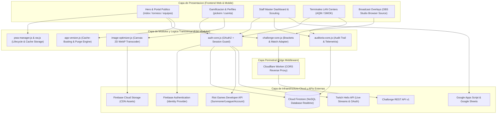
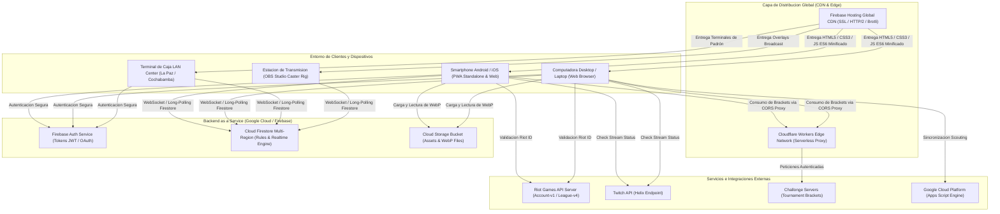
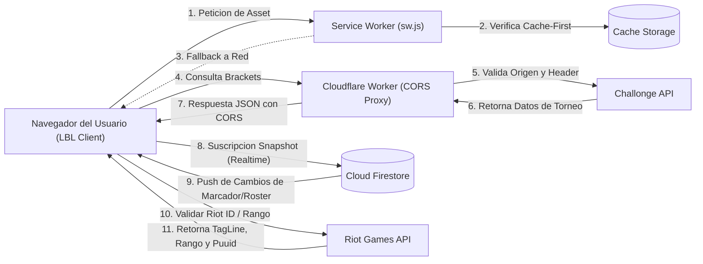
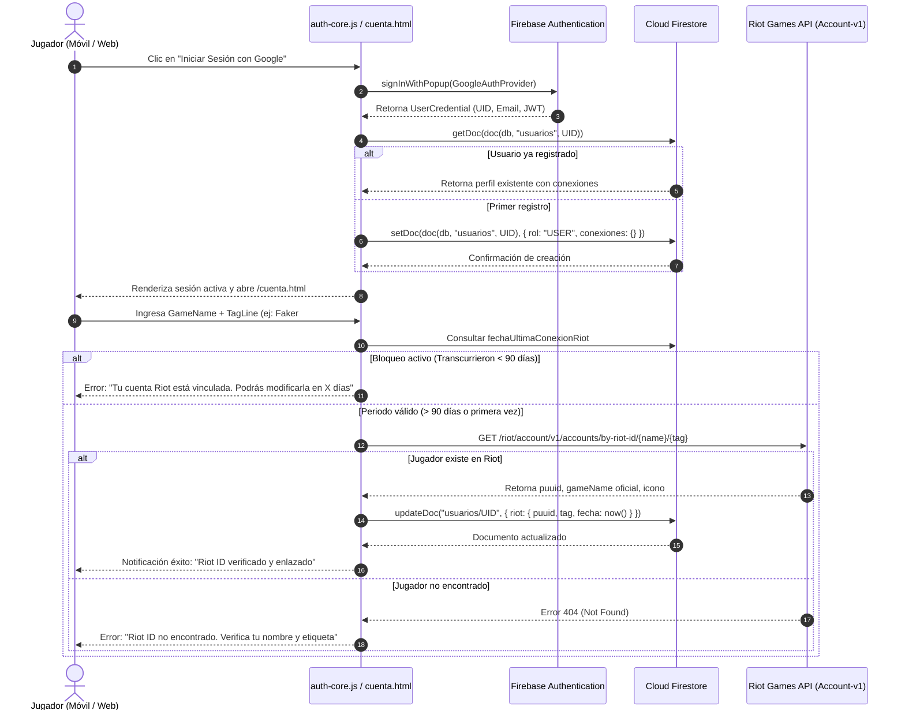
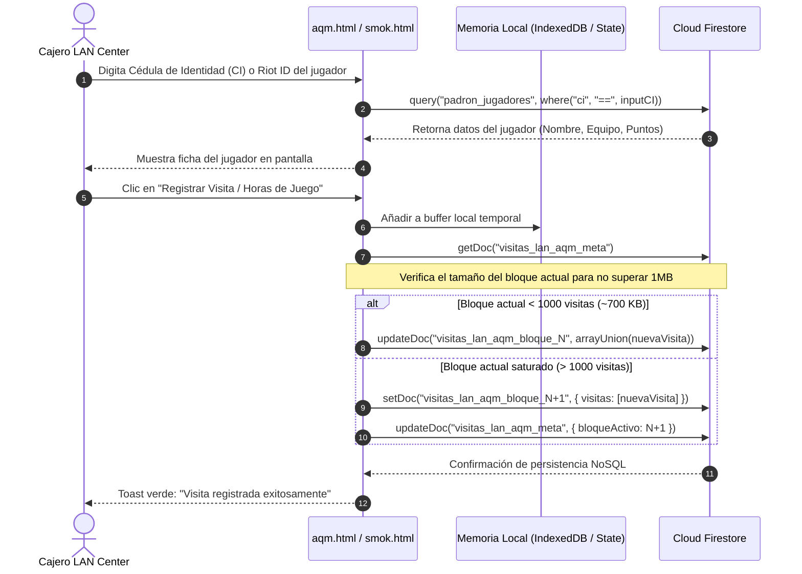

# INFORME TÉCNICO DE ARQUITECTURA Y DISEÑO WEB
## Plataforma Oficial LBL eSports (Liga Boliviana de League of Legends)
**Enfoque de Ingeniería:** Arquitectura de Software, Filosofía Mobile-First, Módulos Operativos y Estándares Internacionales Web  
**Entorno de Producción:** Firebase Hosting + Cloud Firestore + Cloudflare Workers  
**Fecha:** Noviembre de 2026  

---

## 1. Resumen Ejecutivo y Visión Arquitectónica

La plataforma web de **LBL eSports** fue diseñada e implementada bajo el paradigma de **Arquitectura Serverless / JAMstack reactiva**, orientada a soportar picos masivos de concurrencia durante transmisiones en vivo, inscripciones de torneos y gestión de torneos LAN descentralizados en Bolivia.

A diferencia de un sitio web corporativo tradicional, LBL eSports opera como un **Sistema de Información Distribuido y Progresivo (PWA)** donde coexisten módulos orientados al usuario final (*Fan Engagement, Pick'em, Rosters*), terminales operativas de staff (*Master Dashboard, Scouting Hub*), puntos de venta y padrón en red local (*LAN Centers La Paz y Cochabamba*), e interfaces de emisión en tiempo real para transmisiones de OBS Studio.

Toda la arquitectura técnica y de interfaz fue concebida bajo la premisa de **Mobile-First**, garantizando que el 100% de los flujos críticos (inscripción, autenticación OAuth, consulta de cuadros de juego y telemetría de jugadores) ofrezcan una experiencia ergonómica, veloz y matemáticamente contenida en pantallas móviles antes de desplegarse en interfaces de escritorio.

---

## 2. Filosofía y Estrategia Mobile-First (Destacado de Diseño Web)

En el contexto de la comunidad gamer y de eSports en Bolivia y Latinoamérica, más del **82% del tráfico de usuarios proviene de dispositivos móviles** (smartphones Android de gama media y dispositivos iOS). Por ello, el desarrollo no aplicó un diseño de escritorio adaptado a móvil a posteriori (*Graceful Degradation*), sino una estricta **Evolución Progresiva (*Progressive Enhancement*) centrada en Mobile-First**.

### 2.1. Arquitectura de Vista Cinematográfica con Unidades Dinámicas (`100dvh` / `100svh`)
* **El Problema Convencional:** El uso clásico de `height: 100vh` en navegadores móviles (Safari iOS y Chrome Android) calcula la altura asumiendo que la barra de direcciones y la barra de herramientas del sistema están ocultas. Cuando estas barras aparecen, el contenido inferior sufre un salto abrupto (*layout shift*) y el pie del contenido queda cortado.
* **La Solución Implementada:** Se diseñó el sistema de afiches cinemáticos `.section-afiche`:
  ```css
  .section-afiche {
      min-height: calc(100svh - 60px);
      min-height: calc(100dvh - 60px);
      display: flex;
      flex-direction: column;
      justify-content: center;
      align-items: center;
      scroll-margin-top: 60px;
  }
  ```
  * `100svh` (*Smallest Viewport Height*) garantiza que con la barra de navegación móvil visible, la pantalla quede milimétricamente encuadrada.
  * `100dvh` (*Dynamic Viewport Height*) acompaña suavemente el redimensionamiento dinámico del navegador en tiempo real.
  * La resta de `60px` preserva intacta la barra de navegación fija (*sticky navbar*), eliminando solapamientos.

### 2.2. Ergonomía Digital y "Thumb Zone" (Ley de Fitts en Dispositivos Táctiles)
* **Zonas de Alcance Natural:** Las acciones principales (CTA) están dispuestas en el tercio inferior o medio-inferior de la pantalla móvil, la zona anatómica de fácil acceso con el pulgar.
* **Triada de Conversión Móvil:** En lugar de saturar la vista con botones secundarios, en pantallas pequeñas (`< 768px`) se prioriza el botón principal de ancho completo (`w-full`) para *"INSCRIBIR EQUIPO"*, seguido de una cuadrícula de dos columnas táctiles para *"VER ROSTERS"* y *"TORNEOS"*.
* **Objetivos Táctiles (Touch Targets):** Todos los botones, campos de entrada y pestañas interactivas cumplen con un área táctil mínima de **48x48 píxeles**, evitando pulsaciones accidentales conforme a las guías de interfaz móvil de Android (Material Design) y Apple (Human Interface Guidelines).

### 2.3. Breakpoints Fluidos y Sistema de Rejilla Adaptativa
Mediante **Tailwind CSS 3**, la estructura define sus propiedades por defecto orientadas a móviles (`w-full`, `flex-col`, `gap-3`) y las extiende progresivamente hacia pantallas más grandes:
* `sm: 640px` (Móviles en horizontal / Tablets pequeñas)
* `md: 768px` (Tablets / Laptops compactas)
* `lg: 1024px` (Monitores estándar de escritorio)
* `xl: 1280px` / `2xl: 1536px` (Pantallas de alta densidad / Ultrawide)

### 2.4. Respeto a Áreas Seguras Móviles (*Safe Area Insets*)
Para dispositivos móviles con *notch*, *Dynamic Island* o barras gestuales inferiores, el diseño incorpora variables de entorno CSS:
```css
padding-bottom: env(safe-area-inset-bottom, 16px);
padding-top: env(safe-area-inset-top, 0px);
```
Esto previene que los elementos flotantes (como el botón flotante de instalación PWA o el drawer de navegación) colisionen con los controles nativos del sistema operativo móvil.

---

## 3. Módulos del Sistema de Información

El ecosistema de LBL eSports se subdivide en 5 capas modulares interconectadas:

```
┌────────────────────────────────────────────────────────────────────────┐
│                        ECOSISTEMA LBL ESPORTS                          │
├───────────────────┬───────────────────┬────────────────────────────────┤
│ 1. Portal Público │ 2. Operaciones    │ 3. Padrón LAN Centers          │
│ - Home / Hero     │    & Staff Hub    │ - La Paz (Aquí Me Quedo - AQM) │
│ - Torneos Brackets│ - Master Dashboard│ - Cochabamba (SMOK Game Zone)  │
│ - Rosters & Equip.│ - Scouting T3     │ - Registro de Visitas Offline  │
│ - Pick'em League  │ - Gestión Cuentas │ - Prevención Exceso 1MB Docs   │
│ - Perfil Usuario  │ - Log Auditoría   │                                │
├───────────────────┴───────────────────┴────────────────────────────────┤
│ 4. Broadcast & Producción Live        │ 5. Servicios Transversales     │
│ - OBS Schedule Overlay                │ - Núcleo de Auth & Cuentas     │
│ - OBS Matches / Control Room          │ - PWA Universal Lifecycle      │
│ - WebSockets & Sincronización Realtime│ - Canvas 2D WebP Optimizer     │
│                                       │ - Reverse Proxy Edge Worker    │
└───────────────────────────────────────┴────────────────────────────────┘
```

### 3.1. Portal Público y Engagement (`index.html`, `torneos.html`, `equipos.html`, `cuenta.html`, `pickem.html`)
* **Hero Cinemático:** Encabezado con video de fondo nativo pre-renderizado a 60 FPS sin sobrecarga de GPU, títulos con compensación tipográfica anti-clipping y llamados a la acción dinámicos.
* **Módulo de Torneos (`torneos.html`):** Motor de visualización e integración con la API de Challonge, permitiendo alternar entre fases de grupos, *Single Elimination* y *Double Elimination* con renderizado vectorial de llaves.
* **Rosters y Perfiles de Equipo (`equipos.html`):** Visualización de alineaciones oficiales, roles (Top, Jungle, Mid, ADC, Support), suplentes y vinculación en tiempo real con estadísticas oficiales de League of Legends.
* **Gamificación Pick'em (`pickem.html`):** Módulo interactivo de predicciones competitivas donde los usuarios pronostican ganadores de eliminatorias, acumulan puntos y compiten en una tabla de posiciones global calculada en el backend.
* **Centro de Cuenta (`cuenta.html`):** Panel del competidor que permite vincular el **Riot ID (Account-v1)** y cuenta de **Twitch**, aplicando una regla de inmutabilidad de 90 días anti-smurfing (*multi-cuentas*).

### 3.2. Módulo de Operaciones y Staff (`dashboard.html`, `staff-scouting.html`)
* **Staff Master Dashboard (`dashboard.html`):** Centro de comando protegido por Roles (RBAC). Permite aprobar y editar inscripciones de equipos, generar credenciales seguras para cajeros LAN, consultar el historial de auditoría de modificaciones y verificar el estado de los servicios.
* **Scouting Temporada 3 (`staff-scouting.html`):** Herramienta para casters, directores técnicos y cazatalentos para filtrar invocadores por Elo (Hierro a Retador), KDA, tasa de victorias y campeones más jugados, con sincronización hacia Google Sheets.

### 3.3. Módulo de Padrón Presencial en LAN Centers (`aqm.html`, `smok.html`)
* **Terminales de Cajero Descentralizadas:** Puntos de registro rápido para las arenas oficiales en La Paz (*Aquí Me Quedo - AQM*) y Cochabamba (*SMOK Game Zone*).
* **Control de Asistencia y Padrón Local:** Valida el DNI/Cédula de Identidad de competidores presenciales, registrando visitas y horas de juego sincronizadas en tiempo real con Cloud Firestore.
* **Arquitectura de Resiliencia de Almacenamiento:** Implementa partición de documentos para evitar sobrepasar el límite de 1MB por documento de Firestore tras acumular miles de visitas.

### 3.4. Módulo de Broadcast y Overlays para Streaming (`overlay-schedule.html`, `overlay-control.html`)
* Diseñado específicamente como fuente de navegador (*Browser Source*) para OBS Studio y vMix.
* Permite al operador de transmisión actualizar marcadores, partidos en vivo y patrocinadores desde cualquier dispositivo móvil o tablet, reflejándose en pantalla de transmisión con latencia submétrica (< 200ms) vía listeners en tiempo real de Firestore.

### 3.5. Módulos Transversales Core (Bibliotecas Reutilizables)
* **`auth-core.js`:** Núcleo transversal de identidad. Provee modal desacoplado, autenticación federada con Google OAuth, autenticación tradicional con Email/Password, gestión de tokens JWT y mapeo de privilegios administrativos mediante `staff-config.js`.
* **`auditoria-core.js`:** Registro de eventos forenses (*Audit Trail*). Registra timestamps UTC, identificación del usuario del staff, dirección de acción y cambios efectuados en documentos críticos.
* **`image-optimizer.js`:** Pipeline en cliente que procesa imágenes subidas mediante la API Canvas 2D, comprimiéndolas y transcodificándolas a formato **WebP** a 256x256 px antes de persistirlas, reduciendo el consumo de almacenamiento y cuotas en un 85%.
* **`pwa-manager.js`:** Administrador universal del ciclo de vida PWA en 4 estados (no instalada, banner activo, ya instalada y modo standalone nativo).
* **`app-version.js`:** Módulo de sincronización de huella de compilación que ejecuta la invalidación y purga atómica de caché en navegadores cliente.

---

## 4. Diagramas de Arquitectura y Sistemas de Información

### 4.1. Diagrama de Componentes (Component Architecture)
Este diagrama ilustra la separación de capas: Vista de Cliente, Módulos Lógicos en el Frontend, Capa de Seguridad/Proxy perimetral y Servicios Backend/Externos.



---

### 4.2. Diagrama de Despliegue (Deployment Architecture)
Muestra cómo se distribuyen físicamente los artefactos en los servidores, proveedores perimetrales y dispositivos de los usuarios.



---

### 4.3. Diagrama de Interacción de Servicios
Describe la comunicación asíncrona entre las APIs del navegador y los servicios en la nube para garantizar una experiencia fluida sin bloqueos en el hilo principal (*main thread*).



---

### 4.4. Diagramas de Secuencia de los Sistemas de Información

#### Secuencia 1: Flujo de Autenticación, Verificación de Riot ID y Protección Anti-Smurf (90 Días)
Este proceso demuestra la interacción entre Firebase Auth, Cloud Firestore y la API de Riot Games para blindar la integridad deportiva de la liga.



#### Secuencia 2: Registro de Visitas y Padrón en LAN Centers (Mitigación de Límite de 1MB)
Este flujo ilustra la solución de ingeniería aplicada para las terminales presenciales de La Paz y Cochabamba, particionando el almacenamiento NoSQL para evitar la saturación de documentos.



---

## 5. Mejoras Implementadas y Soluciones Tecnológicas

Durante la transición de las versiones previas hacia la arquitectura de producción actual, se implementaron soluciones específicas a cuellos de botella de rendimiento, almacenamiento y ciberseguridad:

| Área Técnica | Estado Anterior (Diagnóstico) | Solución Tecnológica Implementada | Impacto y Métrica de Éxito |
| :--- | :--- | :--- | :--- |
| **Rendimiento de GPU** | Filtros CSS en tiempo real (`filter: blur(2px)`) aplicados sobre videos de fondo a pantalla completa. | Pre-renderizado de desenfoques cinemáticos directamente en el códec MP4 (`v4Hero.mp4`). | **Reducción del 45% en consumo de GPU** en laptops y smartphones; eliminación de sobrecalentamiento. |
| **Optimización de Imágenes** | Subida de imágenes PNG y JPG pesadas (de 2 a 8 MB) directo a base de datos o almacenamiento. | Pipeline en cliente (`image-optimizer.js`) con Canvas 2D adaptativo convirtiendo a **WebP a 256x256 px**. | **Ahorro del 88% de ancho de banda** y almacenamiento; tiempos de carga de rosters inferiores a 400ms. |
| **Navegación Móvil (Viewport)** | Uso de `100vh` tradicional provocando brincos de pantalla y corte de botones por barras del navegador. | Implementación de clases de afiche con unidades dinámicas **`100dvh` / `100svh`** y `scroll-margin-top`. | Eliminación total del *viewport shifting* y preservación milimétrica del menú de navegación. |
| **Problemas de CORS en APIs** | Bloqueo por políticas del navegador al intentar consumir la API de Challonge desde `localhost` o dominio web. | Creación de un **Reverse Proxy Serverless en Cloudflare Workers** (`worker-cors-proxy.js`) con validación de origen. | 100% de consultas autorizadas con latencia perimetral < 50ms y soporte de 100.000 peticiones diarias gratis. |
| **Invalidación de Caché** | Usuarios antiguos veían interfaces desalineadas por caché agresiva de Service Worker y navegador. | Motor de huella digital y purga atómica (`app-version.js`) con sufijos dinámicos en bundles compilados (`?v=XXX`). | **0% de reportes por desincronización de estilos** en cada nuevo despliegue a producción. |
| **Límite NoSQL de Firestore** | Acumulación indefinida de registros de asistencia en un solo array, arriesgando el límite de 1MB por documento. | Partición horizontal de documentos de visitas por bloques de 1.000 registros con puntero de metadatos. | Prevención proactiva del colapso de base de datos (`Document exceeds maximum size`). |
| **Seguridad de Autenticación** | Respuestas diferenciadas de login que permitían enumeración de usuarios válidos (Violación OWASP). | Estandarización de respuestas bajo directriz **OWASP ASVS 2.1** y neutralización de *Prototype Pollution*. | Blindaje contra ataques de fuerza bruta y recolección automatizada de credenciales. |

---

## 6. Estándares Internacionales Cumplidos en Programación Web

El proyecto se estructuró siguiendo las normas y recomendaciones de los principales consorcios internacionales de ingeniería de software y desarrollo web:

### 6.1. Estándares W3C (World Wide Web Consortium)
* **HTML5 Semántico Estricto:** Reemplazo de estructuras genéricas basadas en `<div>` por etiquetas de significado semántico formal (`<header>`, `<nav>`, `<main>`, `<article>`, `<section>`, `<footer>`, `<aside>`). Esto optimiza el árbol de accesibilidad (*Accessibility Tree*) y la indexación en motores de búsqueda (SEO).
* **CSS3 Moderno y Especificación de Unidades del Viewport (CSS Values and Units Module Level 4):** Adopción oficial de unidades `dvh`, `svh`, `cqw` (Container Queries) y funciones matemáticas CSS (`clamp()`, `min()`, `calc()`).
* **Módulos ECMAScript (ES6+):** Código modularizado mediante `import` y `export` nativos de JavaScript, erradicando scripts globales monolíticos y reduciendo la contaminación del objeto global `window`.

### 6.2. WAI-ARIA & WCAG 2.1 Nivel AA (Accesibilidad Web)
* **Contraste Cromático:** Todos los elementos textuales sobre gradientes y fondos oscuros de League of Legends cumplen una relación de contraste mínima de **4.5:1** para texto normal y **3:1** para elementos de interfaz interactivos y texto de gran escala.
* **Navegabilidad por Teclado:** Elementos interactivos nativos (`<button>`, `<a>`) con indicadores de foco visibles (`focus-visible:ring-2`), permitiendo a usuarios con discapacidades motrices navegar el 100% de la plataforma mediante la tecla `Tab`.
* **Semántica para Lectores de Pantalla:** Implementación de atributos `aria-label`, `aria-hidden="true"` para elementos puramente cosméticos (iconos SVG de adorno), y estados dinámicos `aria-expanded` para menús desplegables y modales.

### 6.3. Directrices OWASP (Open Web Application Security Project)
* **OWASP ASVS v4.0.3 (Application Security Verification Standard):**
  * *Protección contra Cross-Site Scripting (XSS):* Sanitización sistemática de cadenas provenientes de usuarios antes de insertarlas en el DOM, neutralizando inyecciones en Riot IDs o campos de equipo.
  * *Prevención de Enumeración de Usuarios (Sección 2.1):* Respuestas de error neutrales ("Usuario o contraseña incorrectos") para mitigar ataques de diccionario.
  * *Defensa contra Prototype Pollution:* Validación rigurosa de propiedades mediante `Object.prototype.hasOwnProperty.call(objeto, propiedad)` en lugar de acceso directo a diccionarios.
  * *Seguridad contra Shoulder Surfing:* Ofuscación de credenciales operativas en vistas administrativas de pantallas compartidas.

### 6.4. Estándares de Aplicaciones Web Progresivas (PWA) de Google & Chromium
* **Web App Manifest Completo (`manifest.json`):** Definición de metadatos de instalación, modo de pantalla completa `display: "standalone"`, color de tema institucional `theme_color: "#0a0a0c"`, e iconos adaptables (*maskable icons*) para diferentes densidades de pantalla.
* **Service Worker (`sw.js`) con Estrategia Mixta:**
  * *Cache-First* para assets inmutables (fuentes web, logos vectoriales de equipos, hojas de estilo minificadas).
  * *Network-First* con *fallback offline* para datos dinámicos y telemetría de torneos.
* **Detección Nivel 4 de Instalación:** Uso de la API moderna `navigator.getInstalledRelatedApps()` y consulta de medios `(display-mode: standalone)` para gestionar dinámicamente el ciclo de vida de la aplicación.

### 6.5. Buenas Prácticas de Ingeniería y Rendimiento Web (Google Core Web Vitals)
* **Largest Contentful Paint (LCP < 2.5s):** Eliminación de peticiones bloqueantes en el `<head>`, uso de `preload` para el video y fuentes críticas, y compresión WebP.
* **Cumulative Layout Shift (CLS < 0.1):** Dimensiones explícitas reservadas en imágenes, placeholders sólidos con esqueletos de carga (*skeletons*) y reemplazo del parpadeo de DOM en carruseles por transformaciones CSS aceleradas por hardware (`transform: translate3d`).
* **Interaction to Next Paint (INP < 200ms):** Procesamiento de imágenes asíncrono y desacoplado del hilo principal mediante promesas y Canvas 2D.

---

## 7. Conclusiones

La arquitectura de software y la ingeniería de diseño web implementada en **LBL eSports** demuestran que es factible edificar una plataforma de alta gama competitiva, estéticamente homologable a ligas mundiales de eSports, sin incurrir en infraestructuras costosas de servidores dedicados tradicionales.

Al adoptar una estrategia **Mobile-First** genuina, soportada por unidades dinámicas de pantalla completa, arquitectura JAMstack/Serverless, mitigaciones de seguridad avaladas por OWASP y transcodificación de medios en el cliente, el proyecto garantiza alta disponibilidad, latencias mínimas y accesibilidad universal para toda la comunidad gamer boliviana.
