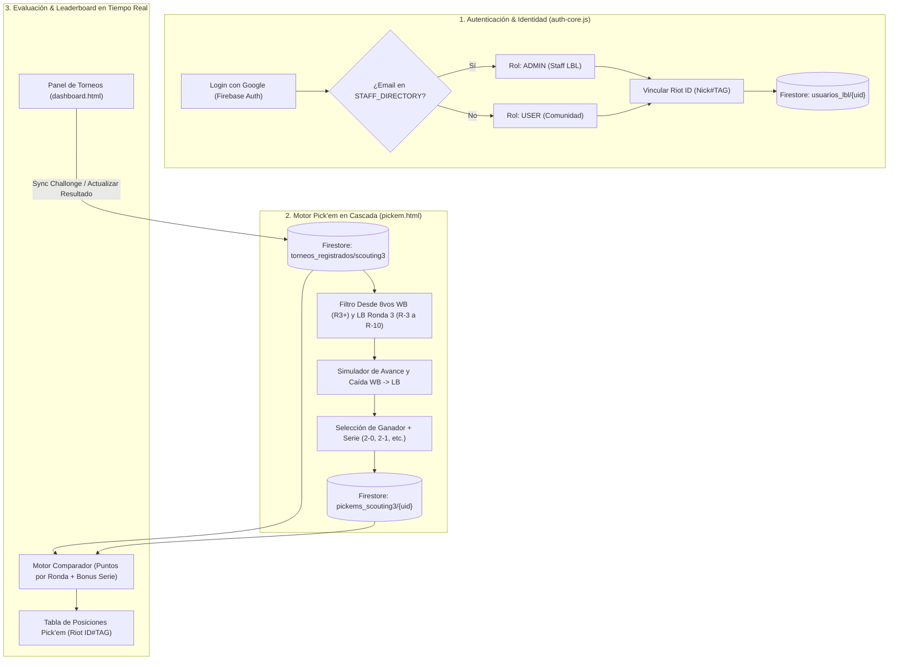

# Plan de Implementación: Pick'em Scouting 3 + Sistema de Cuentas Google (Roles & Riot ID)

## 1. Objetivo General y Alcance
Desarrollar el ecosistema de **Pick'em Oficial del Scouting Tournament 3 (Copa Legion x LBL)** inspirado en la experiencia interactiva de **LoL Worlds Pick'em**, acompañado de un sistema transversal de **Autenticación con Google**, **Roles (`ADMIN` / `USER`)** y **Vinculación de Riot ID (`Nick#TAG`)**.

El sistema partirá exactamente del estado competitivo actual del torneo (**Octavos de Final en Winner Bracket** y **Ronda 3 en Loser Bracket**) y permitirá a los usuarios predecir en cascada todo el camino hasta el Campeón, calculando automáticamente los puntos y el Ranking Global a medida que el Staff actualiza los resultados desde el Panel de Torneos.

---

## 2. Arquitectura del Sistema y Flujo de Datos

---

## 3. Diseño Visual: El Reto del Bracket 100% Simétrico y Estético

Para lograr que un bracket de Doble Eliminación desde **Octavos de Winner Bracket (8 partidas)** y **Ronda 3 de Loser Bracket (8 partidas)** luzca **100% simétrico, alineado al píxel y sin desbordes caóticos**:

### 3.1. Geometría Matemática de Cuadrícula (Fixed-Grid Coordinate System)
En lugar de depender del flujo de altura variable del DOM, el lienzo del Pick'em utilizará una **retícula geométrica estricta** con dimensiones constantes:
- **Ancho fijo de nodo (`Match Card`)**: `240px`
- **Alto fijo de nodo (`Match Card`)**: `84px` (`38px` equipo superior + `38px` equipo inferior + `8px` barra superior de estado/serie)
- **Separación horizontal entre columnas (`Column Gap`)**: `56px` (espacio exacto para trazos ortogonales limpios con codos a `28px`).
- **Alineación Vertical Matemática (`2^n` Centering)**:
  - **Columna 1 (8 partidas)**: Espaciado base uniforme (`gap: 20px`). Altura total exacta del bloque: `8 * 84px + 7 * 20px = 812px`.
  - **Columna 2 (4 partidas)**: Cada tarjeta se posiciona exactamente en el punto medio vertical (`(Y_partidoA + Y_partidoB) / 2`) de las dos partidas que la alimentan.
  - **Columna 3 (2 partidas - Semifinales)**: Centradas exactamente entre sus respectivos Cuartos de Final.
  - **Columna 4 (1 partida - Final de Llave)**: Centrada exactamente en el eje medio (`Y = 406px`).

### 3.2. Estructura de Vistas Simétricas (Navegación Fluida Tipo Worlds)
Dado que Winner Bracket (R3, R4, R5, R6) y Loser Bracket (R-3, R-4, R-5, R-6, R-7, R-8, R-9, R-10) tienen distinta cantidad de rondas (4 rondas en WB vs 8 rondas en LB debido a las rondas de absorción donde caen los perdedores de WB), ofreceremos **3 modos de visualización instantánea** en la barra superior del Pick'em:
1. **Vista Dual Sincronizada (Split Stage / Completa)**:
   - Muestra **Upper Bracket**, **Lower Bracket** y **Gran Final** en un lienzo interactivo con soporte de *Pan & Zoom* suave (arrastrar con el mouse o gesto táctil) y minimapa indicador.
2. **Vista Enfocada por Llave (Tabs: `⚔️ Winner Bracket` | `🔥 Loser Bracket` | `🏆 Fase Final & Gran Final`)**:
   - Permite ver todo el **Winner Bracket (8vos → 4tos → Semis → Final WB)** encajado al 100% en la pantalla de escritorio sin necesidad de scroll horizontal, con simetría perfecta de árbol binario (`8 → 4 → 2 → 1`).
   - En **Loser Bracket**, agrupa visualmente los pares de rondas espejo (`8 → 8 → 4 → 4 → 2 → 2 → 1 → 1`) donde cada par mantiene la misma altura simétrica antes de reducirse a la mitad, mostrando un indicador visual elegante (`⬇ Cae de WB`) en los slots que reciben perdedores del Upper Bracket.

### 3.3. Anatomía de cada Tarjeta Interactiva de Pick'em
Cada enfrentamiento en el Pick'em tendrá:
- **Cabecera compacta**: Identificador de partida (`MATCH #X`), formato (`BO1` / `BO3` / `BO5`), estado (`ABIERTO`, `BLOQUEADO`, `ACERTADO +15 PTS`, `FALLADO`) y puntos en juego.
- **Slots de Equipos (1 y 2)**:
  - Escudo oficial del equipo (`24x24px` WebP/Drive Proxy) + **TAG oficial** en negrita (`SLR`, `KXS`, `PPT`, etc.) + Nombre truncado limpio.
  - Al hacer clic en un equipo, se ilumina con borde y resplandor **Neón Cian (`#06b6d4`)** (o **Dorado (`#eab308`)** en la Gran Final), y **avanza instantáneamente** al slot correspondiente de la siguiente ronda.
- **Selector Rápido de Marcador Exacto (Series BO3 / BO5)**:
  - Cuando el usuario elige al equipo ganador en una serie `BO3`, aparece un micro-selector integrado (`2-0` | `2-1`) en el lateral del equipo elegido (o `3-0` | `3-1` | `3-2` en `BO5`) para optar por el **Bonus de Marcador Exacto**.

---

## 4. Mecánica en Cascada y Reglas de Puntuación

### 4.1. Propagación en Cascada (Winners $\rightarrow$ Losers $\rightarrow$ Campeón)
El motor tomará la estructura real de prerrequisitos de Challonge (`player1_prereq_match_id`, `player2_prereq_match_id`, `player1_is_prereq_match_loser`) a partir de los Octavos de WB y Ronda 3 de LB:
- **Avance por Victoria**: Si el usuario selecciona al Equipo A como ganador de un partido en 8vos de WB, el Equipo A se coloca automáticamente en el partido de 4tos de WB.
- **Caída Automática al Loser Bracket**: Al mismo tiempo, el Equipo B (perdedor de ese partido de 8vos de WB en la predicción del usuario) cae automáticamente al slot correspondiente de **Loser Bracket Ronda 4**, permitiéndole al usuario predecir también su camino en el Lower Bracket.
- **Recálculo Inteligente en Cascada**: Si el usuario cambia de opinión en 8vos de WB, el motor actualiza automáticamente las rondas posteriores donde aparecía ese equipo y limpia únicamente las selecciones afectadas.

### 4.2. Tabla de Puntuación Oficial (Escalonada + Bonus)
Cada vez que el Staff sincroniza o actualiza resultados en el Panel de Torneos, el comparador evalúa las partidas finalizadas desde 8vos WB y LB R3 en adelante:

| Fase / Ronda del Torneo | Puntos por Acertar Ganador | Bonus por Marcador Exacto (BO3/BO5) | Máximo por Partida |
| :--- | :---: | :---: | :---: |
| **8vos Winner Bracket (R3)** / **Loser Bracket R3 y R4** | `+10 pts` | `+5 pts` *(si aplica BO3)* | `15 pts` |
| **4tos Winner Bracket (R4)** / **Loser Bracket R5 y R6** | `+20 pts` | `+5 pts` | `25 pts` |
| **Semifinales WB (R5)** / **Loser Bracket R7 y R8** | `+40 pts` | `+10 pts` | `50 pts` |
| **Final Winner Bracket (R6)** / **Semifinal y Final LB (R9 y R10)** | `+60 pts` | `+15 pts` | `75 pts` |
| **GRAN FINAL SCOUTING 3 (Campeón)** | `+100 pts` | `+25 pts` *(Serie BO5)* | `125 pts` |

> [!IMPORTANT]
> **Política de Bloqueo Anti-Trampa (Locking System):**
> 1. **Bloqueo Automático por Partida:** Cualquier partida que ya tenga estado `live` / `underway` o `complete` en Challonge queda bloqueada individualmente para edición.
> 2. **Control Maestro desde Panel Admin:** Los usuarios con rol `ADMIN` tendrán un interruptor en el panel para **Abierto / Bloquear Ronda / Bloquear Todo el Pick'em** en cualquier momento.

---

## 5. Autenticación con Google, Roles (`ADMIN` / `USER`) y Riot ID

### 5.1. Módulo Transversal de Autenticación (`/public/auth-core.js`)
Crearemos un módulo centralizado e importable en todas las páginas (`index.html`, `torneos.html`, `pickem.html`, `scouting.html`, `dashboard.html`):
1. **Inicio de Sesión con Google (`GoogleAuthProvider`)**:
   - Ventana emergente (`signInWithPopup` con fallback a `signInWithRedirect` en navegadores móviles embebidos).
2. **Asignación Automática de Rol (`ADMIN` vs `USER`)**:
   - Al autenticarse con Google, se verifica si `user.email.toLowerCase()` se encuentra en `STAFF_DIRECTORY` (`/public/staff-config.js`) o si su documento en Firestore tiene `rol === 'ADMIN'`.
   - **`ADMIN` (Staff)**:
     - Activa automáticamente la vista de Staff en toda la web (`lbl_staff_logged_in = true`).
     - Muestra el badge rojo/dorado **`ADMIN • [Nick de Staff]`** en el Navbar con acceso directo de 1 clic al **Panel de Staff (`/dashboard`)**, **Staff Scouting (`/staff-scouting`)** y controles de bloqueo/re-cálculo del Pick'em.
     - También permite acceder a `/dashboard` y `/staff-scouting` directamente con su cuenta de Google sin tener que digitar correo y contraseña manualmente.
   - **`USER` (Usuario Convencional)**:
     - Muestra su avatar de Google, el badge **`USER`** y su **`Riot ID (Nick#TAG)`** vinculado.
3. **Modal de Vinculación de Cuenta Riot (`Nick#TAG`)**:
   - La primera vez que un usuario inicia sesión con Google (o al hacer clic en su perfil en el Navbar), se despliega un modal con estética cyber-esports para ingresar su **Riot ID**:
     - Campo **Nombre de Invocador** (ej. `Faker`) + Campo **Tagline** (ej. `#LAS` o `#BO1`).
     - Validación de formato oficial de Riot (`3-16 caracteres` + `#` + `3-5 caracteres alfanuméricos`).
     - Se guarda en `Firestore -> usuarios_lbl/{uid}` (`riotId: "Nick#TAG"`, `gameName`, `tagLine`, `photoURL`, `rol`, `updatedAt`).

---

## 6. Cambios Propuestos por Archivo

### Componente 1: Núcleo de Autenticación, Roles y Reglas de Firestore
#### [NEW] `public/auth-core.js`
- Implementa `loginConGoogle()`, `cerrarSesionGlobal()`, `abrirModalRiotId()`, `guardarRiotIdUsuario()`, y el observador reactivo `initGlobalAuthUI()`.
- Inyecta automáticamente en el Navbar (escritorio y móvil) el botón **"Iniciar Sesión"** (con ícono de Google) o el **Widget de Perfil de Usuario** (Avatar + `Nick#TAG` + Badge `ADMIN`/`USER` + menú desplegable con "Cambiar Riot ID", "Mis Predicciones Pick'em", acceso a `/dashboard` si es `ADMIN`, y "Cerrar Sesión").

#### [MODIFY] `firestore.rules`
- Añadir reglas de seguridad para las nuevas colecciones:
  - `usuarios_lbl/{userId}`: lectura pública (para mostrar `Riot ID` y avatar en el Leaderboard), escritura permitida únicamente al propio usuario autenticado (`request.auth.uid == userId`) o `ADMIN`.
  - `pickems_scouting3/{userId}`: lectura pública (para ver brackets de otros jugadores en el ranking y calcular posiciones), escritura permitida solo al dueño (`request.auth.uid == userId`) respetando que el torneo no esté bloqueado.
  - `pickem_config/{docId}`: lectura pública, escritura exclusiva para `request.auth != null` (Staff).

---

### Componente 2: Página Exclusiva del Pick'em Scouting 3 (`/pickem`)
#### [NEW] `public/pickem.html`
- **Header & Hero Compacto del Pick'em**:
  - Estado de cuenta del usuario (`Riot ID#TAG`, Rol `ADMIN`/`USER`, Puntos Actuales, Aciertos Exactos y Posición en el Ranking).
  - Barra de progreso de predicciones completadas (ej. `29 / 29 predicciones listas`) y botón **"Guardar Mis Predicciones"** con sincronización en Firestore y feedback visual.
- **Selector de Vista del Bracket**:
  - Pestañas: `🗺️ Vista Completa (WB + LB)` | `⚔️ Winner Bracket (Desde 8vos)` | `🔥 Loser Bracket (Desde Ronda 3)` | `🏅 Ranking Global (Leaderboard)`.
- **Lienzo del Bracket Simétrico (`Pick'em Bracket Engine`)**:
  - Conectores SVG ortogonales dinámicos que se iluminan en color cian cuando el usuario selecciona un avance, en **verde esmeralda (`#10b981`)** cuando el resultado oficial de Challonge confirma que acertó, y en **rojo carmesí (`#f43f5e`)** si el equipo elegido cayó eliminado en la realidad.
- **Tabla de Clasificación (Leaderboard Pick'em)**:
  - Podio Top 3 destacado (Oro, Plata, Bronce) + tabla completa de participantes mostrando su **Riot ID (`Nick#TAG`)**, avatar, aciertos de ronda, bonus de serie exacta, candidato elegido a Campeón y botón **"Ver su Bracket"** para inspeccionar las predicciones de cualquier usuario.
- **Barra de Control Admin (Solo visible para `rol === 'ADMIN'`)**:
  - Botón para forzar sincronización con Challonge, bloquear/desbloquear rondas del Pick'em y recalcular puntuaciones globales en 1 clic.

---

### Componente 3: Integración en Homepage, Torneos y Panel de Administración
#### [MODIFY] `public/index.html`
- **Navbar (Desktop y Móvil)**:
  - Añadir enlace destacado **`Pick'em`** con badge animado y el contenedor de **Login con Google / Perfil Riot ID (`Nick#TAG`) + Badge de Rol (`ADMIN` / `USER`)**.
- **Banner / Acceso Directo en el Inicio**:
  - Añadir llamada a la acción interactiva hacia el **Pick'em Oficial de Scouting 3** para que los visitantes entren directo a armar su bracket.

#### [MODIFY] `public/torneos.html`
- Integrar el widget de Login/Perfil en la barra superior.
- Cuando el usuario visualiza el torneo **Scouting 3 (`TS3LBL`)**, mostrar un botón/pestaña destacada **"🎯 Jugar Pick'em Oficial"** que lleva a `/pickem` (y muestra el resumen de sus puntos si ya inició sesión).

#### [MODIFY] `public/dashboard.html`
- Permitir inicio de sesión directo con Google para los miembros del Staff (`ADMIN`) además del login tradicional.
- Al sincronizar el torneo `scouting3` desde el Gestor de Torneos, disparar automáticamente la actualización de resultados oficiales para que el Pick'em refleje los nuevos puntajes al instante.

#### [MODIFY] `firebase.json` & `public/app-version.js`
- Añadir encabezados `no-cache` para `/pickem` en `firebase.json` y actualizar la versión de caché (`?v=XXX`).

---

## 7. Plan de Verificación en Entorno Local

### Pruebas Funcionales y Visuales (`http://localhost:8000`)
1. **Compilación de estilos y servidor local**:
   - Ejecutar `npm run build:css` y levantar `npm run dev` en el puerto `8000`.
2. **Flujo de Login con Google, Roles y Riot ID**:
   - Iniciar sesión con una cuenta de Google en `http://localhost:8000/`.
   - Verificar que si el correo pertenece a `STAFF_DIRECTORY`, se asigne el rol **`ADMIN`** y aparezcan los accesos de Staff; si es otro correo, se asigne el rol **`USER`**.
   - Probar el modal de vinculación de **Riot ID (`Nick#TAG`)** y comprobar que se muestre en el Navbar y persista en Firestore/LocalStorage.
3. **Simetría Visual y Cascada del Bracket en `/pickem`**:
   - Verificar que el bracket cargue exactamente los cruces de **8vos de Winner Bracket (8 partidas)** y **Ronda 3 de Loser Bracket (8 partidas)** del torneo Scouting 3 (`TS3LBL`).
   - Hacer clic en ganadores desde 8vos WB hasta la Gran Final y verificar:
     - Que los equipos avancen al siguiente nodo con conectores SVG 100% rectos y simétricos.
     - Que los perdedores de WB caigan al nodo exacto del Loser Bracket.
     - Que el selector de marcador (`2-0` / `2-1` / `3-0`, etc.) funcione y guarde la predicción en Firestore.
4. **Cálculo de Puntos y Leaderboard**:
   - Simular/verificar partidas completadas del torneo Scouting 3 y comprobar que el motor asigne los puntos escalonados + bonus por marcador exacto y ordene a los usuarios en la Tabla de Posiciones del Pick'em mostrando su `Riot ID (Nick#TAG)`.
